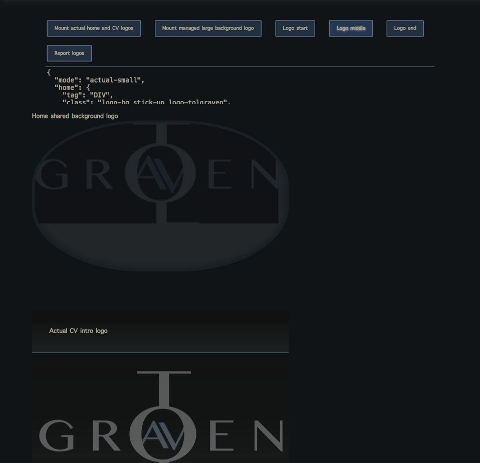
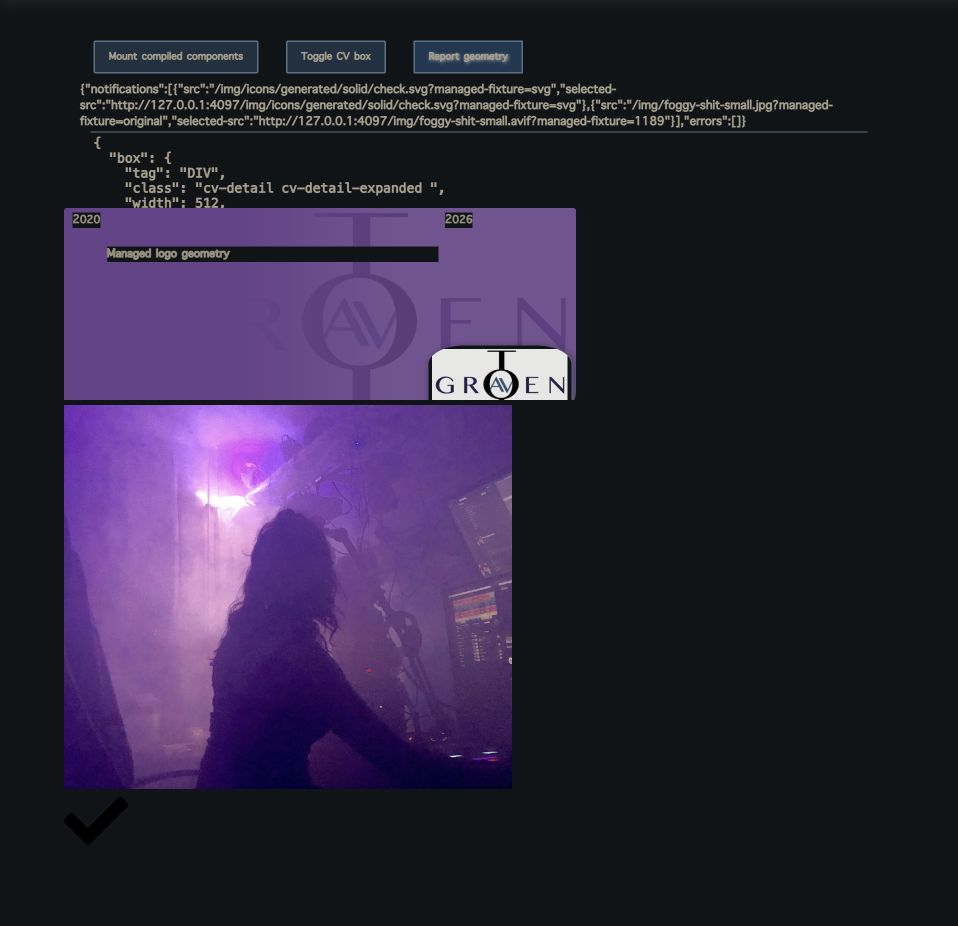

# Managed media integration — 2026-10-13

Native Chrome verification of `6989d787` used isolated browser output, freshly
rendered SSR fixtures, and current CSS. The focused image, media and blog SSR
suite passed 36 tests / 237 assertions. Builds used the shared launcher with
1.5 CPUs and 4 GiB per container; these are functional checks, not performance
benchmarks or proof of live Strapi/Supabase deployment.

The home logo retains its original 3.5-second entrance: 85% at the start,
97.0361% at the midpoint and 100% at completion. No transform is added.
The picture clips to the same rounded boundary as the previous CSS background.

Decorative CV logos retain CSS background sizing (`auto` collapsed, `contain`
expanded). Foreground logos retain their 10em expanded width. The actual large
CV brand logo preserves its original aspect ratio and responsive final source.

Managed photos settle to one sharp final layer; SVGs keep one vector image.
The visible-ready callback fires once after final pixels are visible. The
browser test reports zero failures; the compiler separately logs the known
Phoenix dependency JSDoc warnings. Task-owned tabs and the fixture server were
closed afterward, leaving the user's existing Chrome running.
