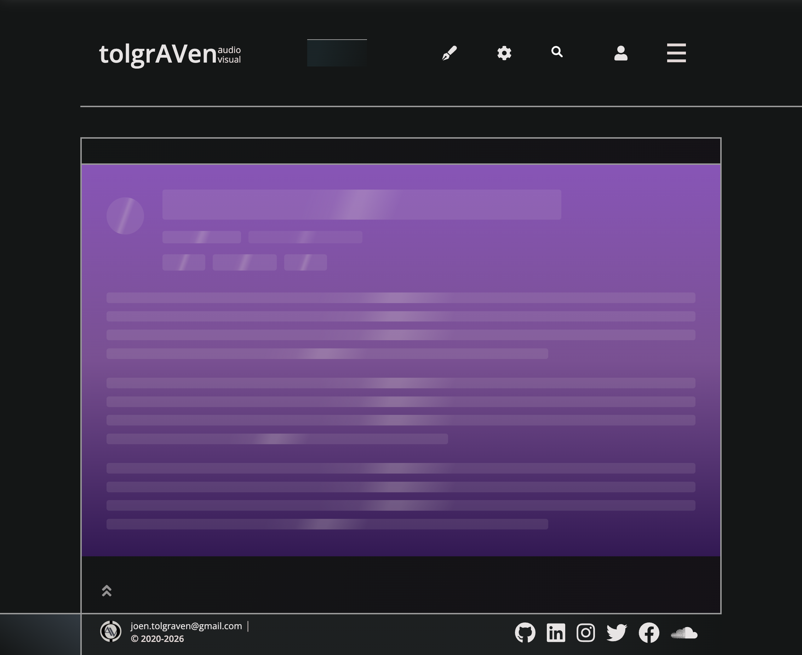

# Production asset ownership

Measured on 2026-10-14 in native Chrome on Apple Silicon. Builds use the shared
CPU controller: 1.5 CPUs, 4 GiB container memory, 2 GiB heap per slot. Native CSS
observations ran with no Docker build reservation and no synthetic CPU probe.
Recorded host load averages were 15.18 / 7.59 / 6.61; these are structural
animation/request measurements, not isolated page-load timing claims.

## Duplicate main entry

The observed production page requested `/bundles/330f28f7b09e/main.js`; its
rendering worker requested
`/js/compiled/out/main.C0677CC0046CAF8C86015BBCCDFC77D0.js`.
Both decoded responses were 1,938,797 bytes with SHA-256
`5bf8eab8d1d643c44d571f5cdd6f156ea8c1f6ea582187f4705621a280b12a6c`.
Each compresses to 470,308 bytes with Python gzip level 9 / mtime 0. This is a
reproducible compression measurement, not the server's negotiated transfer size.

The page, preload hints, return template and worker plan now use Shadow's same
manifest URL. Main is absent from Optimus's bundle inventory, while its released
bytes remain covered by startup's prepared-source digest validation. Workers
still need their separate JavaScript execution context.

In the isolated optimized server, the executed script and return-template main
URL matched exactly. A native worker imported that same URL successfully with
`transferSize: 0` and 1,943,624 decoded bytes, demonstrating browser cache reuse.
The real prepared inventory contained 1,010 assets, 31 independent bundles and
no main bundle; its direct-main whole/range/security checks passed. Focused JVM
delivery/layout checks passed 35 tests / 520 assertions.

## Fonts and initial feature ownership

| Check | Before | After |
| --- | ---: | ---: |
| Shell `@font-face` declarations | 50 | 9 |
| Local Open Sans variable Unicode subsets | 1 | 8 |
| Google-hosted Open Sans subset URLs | 7 | 0 |
| Redundant shell Open Sans TTF face | 1 | 0 |
| Home-declared Markdown/monospace sheets | 2 | 0 |
| Prepared shell CSS bytes | 108,963 | 98,647 |

The ninth face is the existing metrics-only system fallback. All original
Unicode ranges and the 300–800 weight range are preserved. A native FontFaceSet
probe loaded all eight local subsets at weights 400 and 800 without Google
font requests. The installed Dark Reader extension overrides typography, so
that disposable probe explicitly selected Open Sans.

Anonymous Home SSR records neither User nor Blog exports; an explicitly open
account panel still records the User view. Blog link hover/focus retains its
intent preload. A clean Home load did not reproduce an unconditional Blog load;
the old anonymous account boundary did acquire User without intent.

Cold optimized Home requested none of Blog/User JavaScript or Markdown/Blog CSS
before interaction. Opening the account link retained the SPA document and
acquired User assets. This local server lacked browser Supabase settings, so it
showed the existing unavailable/retry state; this does not prove a live login.

On cold CV → SPA Home, the service-icon catalog's CSS/code stayed absent until
the category section approached view. Acquisition-only triggers left no pending
section boxes in service list items and disappeared after activation. Native
scrolling acquired the catalog and displayed the actual glyphs. Other consumers
can independently request the full icon font; this is not a global font ban.

## Optimized bundle ownership

The source-map audit compares the merged module-conventions baseline with the
asset changes using the same selected production modules:

| Resource | Before | After | Change |
| --- | ---: | ---: | ---: |
| Main raw bytes | 1,938,614 | 1,722,445 | −216,169 |
| Main gzip bytes | 475,810 | 415,013 | −60,797 (−12.8%) |
| Markdown gzip bytes | 90,260 | 151,814 | +61,554 |
| All chunks gzip bytes | 1,827,150 | 1,827,418 | +268 |

Reading and editing now share Markdown as a lazy parser ancestor. The optimized
main graph contains no MDAST from/to-Markdown or Micromark sources; the audit
rejects their reintroduction. This moves needed code to its consumer rather than
deleting it. A cold real blog post rendered highlighted inline snippets with the
new split. Module graph tests passed 17 tests / 161 assertions.

External Back on the optimized public Home retained its document identity and
reported `pageshow.persisted = true`; the image direct-return policy was active
and the document/skeleton entrance stayed settled. Successful network SSR uses
`private, no-cache`; known errors and private paired-return documents keep
`no-store`.

## Skeleton animation and lifecycle

The same Node-rendered SSR shell contains 19 skeleton shapes. Native Chrome's
Web Animations API reported:

| Check | Before | After |
| --- | ---: | ---: |
| Running CSS animations | 38 | 1 |
| Animated properties | background-position and opacity | opacity |
| Per-shape animation owners | 19 | 0 |
| Animations after compiled bootstrap completion | — | 0 |

The after fixture loaded the real compiled head and entrance scripts, inserted
the real completion marker, and observed removal of the exact `#ssr-shell`
wrapper after the finite exit. This is a native document/CSS fixture, not an
end-to-end service-content test. The viewport was 1133 × 926 CSS pixels at DPR 2;
the fixture's injected Dark Reader sheet was disabled for both observations.

The foreground native suite passed 461 tests / 2,559 assertions. It exercises
actual IntersectionObserver visibility, hidden-document cleanup, retained root
identity, zero-height placeholders, and intrinsic/explicit inline width with
padding under both box models. Compiled standalone bootstrap checks passed all
24 tests, including gate-before-marker and marker-before-gate cleanup.

