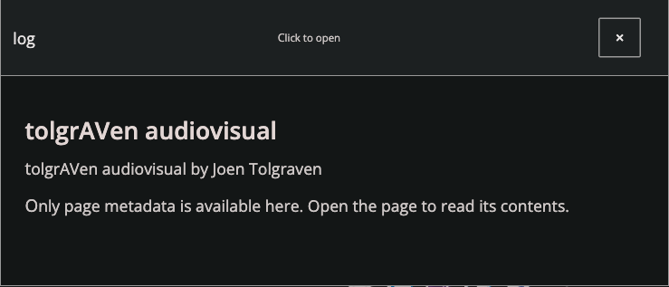

# Composable components with `defc`

Follow [Reagent and re-frame first](reagent-re-frame.md) for state, events,
effects, deferral and justified React adapters.
For the classic/Reagent 2 comparison and the reasons behind the current runtime,
read [Reagent 2 and React 19](reagent-2-react-19-guide.md).

Reusable rendered UI lives in `website.components.*`; feature views live under
`website.modules.<feature>.*`. `website.component.*` implements declaration,
lifecycle, data and state capabilities. Import the owning namespace directly;
there is no `website.views` compatibility entry point. See [source layout](source-layout.md).


Require `[website.macros :refer-macros [defc]]` and
`[website.component.registry]`, and use components in Hiccup.
The default compiles directly to Reagent 2's `reagent.core/defc`: a memoized
function component, with no error boundary, lifecycle class, DOM wrapper or data
loader. Registering its descriptor happens once at definition time. As with
Reagent 2 components, use `[<component> args]`, not `(<component> args)`.

```clojure
(defc <title> [{:keys [title]}] [:h2 title])

(defc <counter> [label]
  :let [*count (r/atom 0)]
  [:button {:on-click #(swap! *count inc)} label ": " @*count])
```

Put component configuration (`:features`, `:depends`, `:state`, etc.) in the
declaration map after the optional docstring, rather than on the component symbol.
Hiccup metadata such as `^{:key ...}` still identifies instances.
The macro accepts an optional docstring and declaration map, one
argument vector (including destructuring and variadic arguments), and optional
`:let [bindings]` for per-instance state. Existing form-2 bodies also work.
Bindings survive argument updates; rendering receives current arguments. Lean
components also accept ordinary multiple render arities. Composed features need
one argument vector. Empty prototype bodies render `nil`, so unfinished definitions
can retain their API during a migration.

The registry is deliberately independent of the component runtime. Leaf views
such as the error fallback can declare lean components without loading the runtime
that uses them. Spec-capable components and explicit capabilities use `website.component`;
non-spec primitives keep the direct Reagent path. `{:spec false}` explicitly
treats the first argument as domain data, including a domain `:features` key.

A `defc` value is a React component descriptor, not an ordinary callable function.
Use `[<component> value]` even inside threading/helper code. At a native React
adapter boundary, use `(r/reactify-component (fn [props] [<component> props]))`
instead of passing the descriptor to `reactify-component`. Module exports may
still use Vars; resolve them with `component/resolve-view` before placing the
result in Hiccup. Mount roots with the component value rather than an unresolved
Var wrapping that value.

## Selecting features

Features are explicit, ordered and registered independently of the macro:

```clojure
(defc <article>
  {:features [:props :error-boundary :links]}
  [spec title]
  [:article [:h2 title] [:a {:href "https://example.com"} "Read more"]])

[<article> {:props {:id "article" :class "compact"}
            :classes ["interactive"]
            :links {:id :article :text "https://example.com"}}
 "An article"]
```

Instance specs use the same ordered feature notation as declarations. When the
first argument contains only features, pass that feature vector directly:

```clojure
(defc <article>
  {:features [:props [:appear {:class "opacity", :once? true}]]}
  [spec title]
  [:article title])

[<article> [[:appear false]] "Already visible"]
[<article> [[:appear {:class "slide-in"}]
            [:seen {:threshold 0.25}]] "Approaching the viewport"]
[<article> [[:on-seen {:event [:article/load 42], :once? true}]]
 "Load the article when seen"]
```

`[<article> [[:appear false]] title]` is equivalent to
`[<article> {:features [[:appear false]]} title]`. The runtime expands the vector
into a spec map before argument/spec validation, configuration/dependency functions,
per-instance bindings and the body. Keyword entries such as `[:seen]` enable a
feature; `[]` inherits all declaration defaults. This applies only to spec-capable
components; inferred non-spec components and explicit `:spec false` declarations
keep vector arguments as domain data.

When also supplying props, a container, dependencies or domain fields, keep a map
and its explicit `:features` key:

```clojure
[<article> {:props {:id "visible-article"}
            :features [[:appear false]]}
 "Already visible with props"]
```

Missing entries inherit defaults. `false` and `nil` disable; `true` inherits an
active default or enables an absent/disabled declaration. Maps shallow-merge with
the default map; scalars replace it. Declaration positions remain stable and new
IDs append in instance order. Repeating an ID keeps its position and last value.
Nested `:features` entries take precedence over legacy top-level feature options.
Legacy top-level options only refine declared IDs; they do not promote unrelated
domain keys into capabilities. Legacy `:container` template and map overrides
retain the declared native attrs/classes/styles; nested `:features` container maps
follow the ordinary shallow merge rule.

A disabled entry does not evaluate its configuration function or call its
transform, wrapper, setup, observer, listener, or subscription code. Options are
resolved once for each component argument render; lifecycle state has one owner
per mounted instance and remains separate from those pure options. Root features
may be added, configured, or removed on the same mounted instance without
remounting its body. Removal releases the current owner; unmount releases all
current owners in reverse feature order, even if another cleanup throws.

Structural wrappers (`:container`, `:error-boundary`, `:data`, or custom `:wrap`)
can be selected by the initial instance spec. Changing their membership after
mount requires an explicit Hiccup key/remount; the runtime reports a clear error
instead of silently losing form state. A transform that changes the native root
structure under a feature toggle has the same constraint. The wrapper guard checks
membership, not every returned wrapper shape. Custom
configuration-only changes must preserve wrapper/component identity. Legacy
container template/tag/view switches retain their established React remount
behavior; callers should explicitly key deliberate structural changes. Full pages
retain their required
recovery boundary; declaration-owned dependencies retain their data boundary.
`:presence` can use a native parent or fragment and evaluates each child's actual
instance `:exit` options, including the retained form during removal.

This is runtime gating, not compiler pruning: a dynamic override cannot remove
shared code from a JavaScript bundle. The spec runtime uses six fixed direct hooks
(one composition ref, one body ref, one hydration context, one refresh state, two
layout effects) regardless of active feature IDs; optional owners do not add
conditional hooks. Non-spec primitives incur none of these added runtime hooks; existing instrumentation
is unchanged. Inactive
hooks still execute; the resource-heavy feature work stays unacquired. No timing
claim follows from the hook count.

`(when enabled? ...)` is appropriate inside a pure transform or owned setup/effect.
It cannot conditionally call hooks or insert/remove React ancestors around a live
body: hook ordering and component identity still have to remain stable. The shared
runtime provides that stable ownership, so normal usage stays ordinary Hiccup.

| Feature | Behavior | Adds a class? |
| --- | --- | --- |
| none | Native Reagent function component | No |
| `:container` | Optional layout root outside other features; merge caller attrs there | No |
| `:props` | Merge first-argument `:props` / `:classes` into a native DOM root; preserve both refs | No |
| `:data` | Enable dependencies supplied in the first argument's `:depends` | No |
| `:error-boundary` | Isolate render/initialization/descendant lifecycle failures; log and offer retry | Yes, a boundary around the function body |
| `:lifecycle` | First-argument `:init` / `:exit` through layout effects | No |
| `:links` | Existing link-preview discovery, update and cleanup | No |
| `:appear` | Enter animation merged onto the native root | No |
| `:seen` | Viewport visibility merged onto the native root | No |
| `:on-seen` | Dispatch an event/callback from shared native-root visibility | No |
| `:font` | Shared font acquisition and an owned text crossfade | No |
| `:exit` | Exit animation when removed by a presence-enabled parent | No |
| `:presence` | Retain keyed direct children until exit completion | No |

Definition-level `:depends` automatically enables data handling. The macro recognizes a first argument named `spec`, `opts` or `options`, or a map
destructuring feature keys such as `props`, `classes`, `features`, `depends`, `appear`, `seen`
or `links`. Other arguments are domain data, even if their map happens to contain
keys named `:props` or `:depends`. No spec argument needs to be added when absent.
A feature may be `[id config]`; `[id false]` or `[id nil]` disables it.
Require the namespace that registers a feature (for links,
`website.modules.link-preview.views`) before using it.

Root props only apply to native DOM roots, never fragment, child-component or
React-interop roots. Link discovery needs a native DOM root. Feature composition
itself adds no DOM wrapper; a custom feature may deliberately add one.

Ordinary Hiccup callback refs receive the node on attachment and nil on detachment.
Use a plain atom, for example `:let [*node (atom nil)]` and
`[:div {:ref #(reset! *node %)} ...]`, when retaining a node should not rerender.
Reagent/React owns those calls; no manual release manager is needed. Root/media
components use `react/compose-refs` only to forward internal and caller refs.
Explicit React 19 callback cleanup is forwarded instead of calling that callback
with nil; other composed refs still receive nil. Keep native nodes/refs opaque.

React keys are excluded from props. The narrowly scoped
`component/compat.cljs` adapter retains original Hiccup metadata from Reagent
2.0.1 function state; it is the only backing-subvec access. Preserve keyed state,
form-2 and class/function identity tests before changing that library boundary.

Register a feature with `component/register-feature!`:

- `:transform (fn [hiccup instance-spec config] ...)` transforms the body's
  Hiccup; transforms run in declaration order.
- `:wrap (fn [hiccup definition config] ...)` wraps the composed body; the first
  declared wrapper is outermost.
- DOM features supply `:setup (fn [config] state)`, `:mount (fn [state element])`
  and `:unmount (fn [state])`. They run after commit. Rootless owners declare
  `:root? false`; DOM owners wait for the native root. Changing configuration or
  root replaces the owner unless `:reconfigure (fn [state config] state)` updates
  its existing ownership. Returning the identical state avoids an extra refresh.
- A stateful native-root renderer may supply `:render (fn [hiccup config state]
  {:form hiccup, :commit! (fn [element] ...)})`. Render stays pure; the commit runs
  only for the owner state used by that render. Built-in motion, presence and font
  adapters use this path rather than installing their own conditional hooks.
  Commit work must be idempotent and own cancellation through `:unmount`.

No macro edit is needed to add another feature. Select the boundary outside
features whose failures should be contained.

## Root-merged appearance and actual removal

```clojure
(defc <card>
  {:features [[:appear "slide-in"] [:exit {:timeout-ms 1500}]]}
  [{:keys [title]}]
  [:article.card [:h3 title]])

(defc <cards> {:features [:presence]} [cards]
  (into [:section.cards]
        (map (fn [card] ^{:key (:id card)} [<card> card]) cards)))

(defc <viewport-card>
  {:features [[:seen {:class "slide-in" :threshold 0.5 :once? true}]]}
  [title]
  [:article [:h3 title]])
```

`:appear` and `:seen` merge the existing `appear-wrapper`, animation kind and
`appeared` classes onto the component's own root. There is no wrapper element or
React component; `appear-wrapper` is a CSS class retained for selector compatibility. Original classes, styles and refs are preserved. `:appear` waits
for the initial frame before adding `appeared`. If its committed native root is
offscreen, it uses the same observer as `:seen` and enters once it reaches the
viewport. Settled local/history restoration stays visible. `:seen` retains `seen-merge`'s
20% observer steps and 50% visibility decision, so its slide does not repeatedly
reverse itself around a single 50% observer boundary. An explicit non-default
`:threshold` selects that observer threshold; `:root-margin` and `:once?` are configurable. Without
IntersectionObserver it falls back to appearing immediately after the initial
frame. `:force true` skips waiting for visibility. Use either `:seen` or `:appear`;
when both are selected, visibility controls the reveal.

For removal, the parent selects `:presence` and its keyed direct children select
`:exit`. Remove a child from the parent's collection normally. The parent keeps
that same child instance only while exiting, removes `appeared`, adds `exiting`
and any configured exit `:class`, and finally lets React unmount it. Committed
Hiccup history is nonreactive; only asynchronous exit completion invalidates the
parent. Fresh inline callbacks must not create an idle render loop. The existing
appearance CSS reverses by default; custom exit classes can define another
transition or keyframe animation. Exiting roots are inert and aria-hidden.

Root animation/transition completion releases the child. A bounded timeout handles
paused/infinite animations or missing completion signals; `:timeout-ms` overrides
the computed CSS-duration fallback, with a maximum of 10 seconds. Reduced motion
skips animations and releases exits promptly. Reintroducing the same key during
exit cancels removal and preserves state. Changing the key creates a new instance.
Observer, frame and deadline work is cleaned up on unmount.

The parent must remain mounted during exit: React cannot defer removal from a
child's unmount callback. Removing the whole parent removes its subtree at once.
Place `:presence` on a higher surviving parent to animate that parent as a child.
Managed children must have stable, unique Hiccup metadata keys, and both features
need native DOM roots. They reject fragments/component roots rather than silently
adding wrappers. Nested lists should put `:presence` on their own direct parent.
Only removed children are retained, and only until completion; no hidden DOM is
kept after exit. Declare `:seen` and `:appear` on the owning component; the
root features require no wrapper.

## Data dependencies, before mount

Dependencies are ordinary resource descriptors. Declare a vector, or a function
of the component's arguments returning that vector:

```clojure
(defc <article-page>
  {:features [:error-boundary]
   :depends (fn [id]
              [{:source :strapi :keys [:blog]}
               {:source :url :url (str "/api/articles/" id)
                :into [:articles id]}])}
  [id]
  [:article @(rf/subscribe [:get :articles id :title])])

;; Starts every request now, without constructing the component body or DOM.
(component/preload! <article-page> "welcome") ; Promise, errors reject
(component/prefetch! <article-page> "welcome") ; speculative, errors reported

[<article-page> "welcome"]
```

On acquisition, `:component-data/status` starts the shared source queue before
mounting; its reaction only reads status. Component bodies observe the managed
subscription rather than invoking transport work. Preloads acquire the same
queue before/alongside module code. SSR status only reads supplied snapshots.
The body is created after
all required resources are ready. A `role=status` loading placeholder is shown
until then; set definition `:loading` to custom Hiccup to replace it. Failures
produce a visible alert with **Retry data**, plus the existing service
notification/log. Identical in-flight descriptors share requests, including
preloads and later mounts. One failing dependency does not prevent the others
from starting. Retry invalidates those dependencies and starts a new attempt.

Built-in sources:

```clojure
{:source :url :url "/api/example" :into [:example]}
;; JSON with keyword keys by default; :format :text for text responses.

{:source :app-db :path [:content :blog]}
;; Existing nil/false values count as loaded; an absent path is awaited.

{:source :app-db :path [:content :blog]
 :load {:source :strapi :keys [:blog]}}
;; Start a producer when absent, then wait for the app-db value.

{:source :strapi :keys [:blog]}
;; Existing backend-mediated content client installs into [:content ...].

{:source :supabase :query {:path-collection [:blog-posts]}
 :into [:loaded :posts]}
;; Uses existing authenticated read-once query/filter rules; no new stream.
```

`:into` installs the result into app-db. Use distinct paths for independently
rendered resources (for example `[:articles id]`); cache hits do not repeatedly
write over app-db. If different in-flight resources target the same path, the
newer request owns the destination and an older completion cannot overwrite it.

Remote snapshots default to a 60-second TTL and 15-second request deadline;
positive `:ttl-ms` / `:timeout-ms` override these. Completed cache entries are
bounded to 128 (in-flight requests are retained). App-db and Strapi readiness
comes from current app-db values. Account/client changes invalidate URL and
Supabase snapshots, reject pending waiters, and clear values installed by those
resources if another writer has not replaced them. A late old response cannot
install. Failures remain explicit until retry, avoiding automatic retry loops.

Custom sources register via `data/register-source!` with `:load!` returning a
value or Promise. Optional `:read` returns `{:ready? boolean :value value}`;
optional `:scope` partitions the request cache (for example by session).

## Loading views and skeletons

Missing dependencies use the inferred native root and classes by default.
Choose `:loading-prefab` for a skeleton, or `loading/<spinner>` explicitly. A static Hiccup `:loading` value or
a function of current component arguments can build a skeleton:

```clojure
(require '[website.component.loading :as loading])

(defc <profile>
  {:depends [{:source :url :url "/api/public-profile" :into [:profile]
              :persist {:scope :public :ttl-ms 300000}}]
   :loading [:section {:role "status" :aria-label "Loading profile"}
             [loading/<avatar>]
             [loading/<h1> {:style {:width "18ch"}}]
             [loading/<lines> {:count 3}]
             [loading/<box> {:style {:min-height "12rem"}}]]}
  []
  [:article @(rf/subscribe [:get :profile :name])])
```

Helpers include `<span>`, `<h1>`, `<h2>`, `<box>`, `<avatar>` and `<lines>`. They
accept ordinary DOM attributes/styles and are aria-hidden so the enclosing status
label describes the loading state. Skeleton pulse and spinner rotation respect
reduced motion. Errors still show the existing retry UI instead of a skeleton.

## State that survives unmounts

```clojure
(defc <filters>
  {:state {:scope :page :initial {:search "" :expanded? false}
           :persist {:scope :public :ttl-ms 86400000}}}
  []
  (let [*state (component/state)]
    [:input {:value (:search @*state)
             :on-change #(component/>update *state assoc :search (.. % -target -value))}]))
```

`component/state` returns a native re-frame subscription. Dereference it to read;
use `component/>reset` and `component/>update` to dispatch writes through events.
Unmounting does not delete the value. Call it in the
render body; no `:let` is needed. Options on that call override definition defaults.

Paths are populated automatically under `[:component component-ns component-name instance-key ...]`, using the
component namespace/name. `:scope :page` adds the current pathname and query;
the default scope shares state across navigation. `:key` (a value or function of
component arguments) distinguishes instances such as editors for different posts.
`:id` overrides the component identity. Key precedence is the React/Hiccup metadata `^{:key ...}`, then the manual
`:state :key`, then no key segment. Without either key, all instances of the same
component share state. React keys are carried through data/error-boundary wrappers.
Existing app-db values win over disk
snapshots, and snapshots win over `:initial`; nil/false are valid stored values.
When calling outside `defc`, provide an explicit `:id`.

## Local snapshots and returning from another site

Persistence is opt-in: state uses `:state {:persist ...}`, and data descriptors use
`:persist ...`. Only these declared values and the public CMS bundle are saved,
not the whole app-db. `component/dump-state!` and `component/dump-content!` enqueue
the respective tracked snapshots. State updates are debounced, and
pagehide/visibilitychange flush pending snapshots before leaving the document.

Snapshots use versioned EDN, a default 30-minute expiry and a 2 MiB per-owner envelope size
limit. Set `:version` to invalidate a changed data shape and `:ttl-ms` to choose its
lifetime. Expired, malformed or incompatible snapshots are cache misses. Explicit
data retry discards its disk snapshot before fetching. Storage failures do not
break the page and failed writes produce a visible service notification.

UI state, app-db dependencies and Strapi default to public scope. URL and Supabase
resources default to account scope; they cannot restore until an authenticated
owner is known. Use `:persist {:scope :public}` only for public endpoint data.
Use `:persist {:scope :user}` for private state. Account-specific state paths and
resource snapshots are isolated by account; old account callbacks cannot install
new values. Persistence stores data, never the client's credentials/session.

At component creation, a valid resource snapshot is installed synchronously
before loading is considered, so it needs no spinner and starts no network
request. On external history return, the public CMS bundle is also restored
before bootstrap fetches missing sections. Embedded server content takes priority.
A browser back/forward-cache restore already retains its live app-db and DOM.

Network SSR owns the original document/hero entrance in CSS before hydration;
hydration retains that clock and the existing native nodes. Initial `:appear`
roots carry `data-document-appear`; offscreen `:seen` roots resume viewport
observation after hydration. Local/external-back restoration suppresses entrances.
A later route change clears that context. Ready
server-injected `:into` values are adopted as resource snapshots during restoration.
Missing data still loads and gets a spinner; bypass never means rendering fake
empty content. The core's explicit `data-hydrate="true"` root contract selects
`hydrate-root`, waits for route/module readiness, and leaves existing server DOM
in place while preparing it. Only mark a root when its markup and initial app-db
represent the same component tree; ordinary server placeholders use create-root.
The server renderer must supply matching state/content before hydration. See [page rendering](ssr.md) for the shared server implementation.

## Modules, viewport prefetch and SSR

`content.contract/module-dependencies` is a shared CLJC manifest available before
module JavaScript loads. The loader starts known data requests alongside the
chunk download, then joins module and selected-view dependencies before init.
Module specs may declare `:depends`; retain the shared manifest for requests that
must start before that module's code is available. Existing `:content` remains
supported during migration.

`[component/<prefetch> resources]` starts requests when its one-pixel sentinel
comes within 800px of the viewport, with immediate fallback without
IntersectionObserver. Auto sections combine their declared `:depends` with
legacy content requirements. Explicit `component/preload!` also works from route,
hover or navigation preparation, without needing a sentinel or mounted view.

Page declarations and public read plans live in CLJC and are consumed by JVM
source adapters and the CLJS renderer. Credentials stay in server/client adapter
configuration, never component descriptors.

## Error recovery

Render boundaries and failed required dependencies share the component fallback
with retry and expandable diagnostics. Event/transport failures use registered
error effects. Keep cached content visible during refresh failures and report
those through the HUD; do not add duplicate banners above usable content.

Use `defpage` for page components; its error boundary resets on route changes.
See [testing](testing.md) for mounted lifecycle and browser checks.

## Shared work queues

Storage reads are queued once per owner per document. Application startup awaits
`storage/ready!` before rendering, then components read the in-memory index. A
150 ms state/content debounce coalesces snapshot requests. Small preferences and
navigation snapshots stay in localStorage. Public content, managed resources and
`:store`/`:content` caches use an IndexedDB owner transaction with separately encoded
Transit entries. Entry decoding/validation yields a painted frame after 32 entries
or a 6 ms batch. Older EDN envelopes retain their already encoded heavy cache in
a separate localStorage migration backup until its IndexedDB commit succeeds.
Small preferences and drafts still save synchronously during migration; backup
restoration contributes only heavy entries, preserving small-state removals.
Store readiness is independent: failed IndexedDB reads preserve unseen heavy data
while readable localStorage drafts remain available for restoration and saving.
A failed transaction retains the backup. A single large legacy entry can still
take a long first-time parse, so measure migration separately from subsequent loads.
Equal, unexpired values do not produce another write. Components only read the
in-memory index. `pagehide` synchronously flushes small navigation preferences;
heavy writes already queued during ordinary updates remain asynchronous. A return
hint is published only after the heavy public cache commits. Cold reads cannot
overwrite edits or resurrect explicit removals; serial writes discard superseded
work before encoding and publication.

Dependencies register pending promises synchronously and adapters start together
on the next tick. Repeated resources share a promise. Strapi unions all section
keys queued in that tick into one `/api/content?keys=...` request. Modules and
components use the same queue, including `website.modules.main.module/spec` and its
explicit shell dependencies in the shared backend/frontend manifest.

```clojure
;; Subscribing requests the owning section; all values still come from app-db.
@(rf/subscribe [:content [:blog :heading]])

;; Explicit preloading, independent of mounting/subscribing:
(rf/dispatch [:content/load [:blog :common]])
(rf/dispatch [:component-data/load
              [{:source :supabase :query {:path-collection [:blog-posts]}}
               {:source :strapi :keys [:blog :common]}]])
```

Re-frame disposes content/state reactions when their last consumer unmounts;
app-db values remain. Supabase live readers are shared per table, queued, and
closed when their last query is disposed. Loaded snapshots remain available
immediately on remount while the reconnected stream refreshes missed changes.
Explicit Supabase preloads are one-shot reads, deduplicated by normalized query,
and populate the cache used by subsequent subscriptions without opening a channel.
Strapi batches disjoint sections; Supabase shares identical queries and live table
readers, rather than combining unrelated SQL reads into an invented batch API.

## Scoped subscription and write shortcuts

`defc` makes `<sub`, `>reset`, and `>update` available locally. No `:state`
declaration is needed unless configuring component keys, defaults, or persistence.

`<sub` returns the actual `:component-state/scoped-value` subscription. Its derived
reaction reads app-db, with a pure fallback for a missing path. A `:state` declaration
initializes defaults through a committed effect and registered event. It may be a
map or a pure function of the component arguments returning that map.

With `:persist`, acquiring the value subscription dispatches `:component-state/load`.
That event shares the idempotent initialization effect: seed missing defaults,
register persistence, await the shared storage queue, then dispatch a restore result.
Existing state is retained, and intervening edits win over late restoration. Eager
owners can dispatch `[:component-state/initialize resolved-path options]` before
mounting; the later subscription does not repeat the snapshot read. No separate
boolean owner subscription is needed. SSR reads its supplied state without disk IO.

```clojure
(defc <setting>
  {:state {:initial {:opts {:setting false}}}}
  []
  :let [*setting (<sub :comp [:opts :setting])]
  [:button {:on-click #(>update *setting not)} (str @*setting)])
```

`<sub` returns a native re-frame subscription; `@*setting` reads the value.
A weak index retains its resolved write destination without storing application
values, so write helpers accept it directly without dereferencing it or requiring a tuple.
`(component/path-of *setting)` returns the resolved vector when needed.

| Scope | Expanded path |
| --- | --- |
| `:comp` (or `:component`) | `[:component "namespace" "component-name" optional-key ...path]` |
| `:module` | `[:module module-id ...path]` |
| `:page` | `[:page page-key ...path]` |
| `:global` (or `:shared`) | `[:state ...path]` |

Module identity comes from `:module` in the call options or component declaration,
then the component namespace's registered module, falling back to `:main`.
Outside a component, module subscriptions require `{:module :blog}` (for example).
Page identity defaults to the current pathname and query; `{:page page-key}` overrides it.

Component instance identity comes from Hiccup `^{:key ...}`, then `:state :key`;
without either, instances share state. Bindings in `:let` initialize once per
instance: use a React key to remount when logical identity changes. Calls in the
render body resolve current arguments instead. Captured handles and resolved paths
retain their routing context in callbacks after render has finished.

- `(>reset handle-or-path value)` queues replacement, like `reset!`.
- `(>update handle-or-path f & args)` queues an atomic update, like `swap!`.
- `(<sub :comp path {:initial value})` supplies a pure fallback for a missing leaf;
  put app-db defaults in the owning `:state` declaration or initialization event.
- Use `>reset`/`>update` for writes; native handles are read-only subscriptions.
- Component `:state {:initial {...} :persist true}` restores/persists the whole
  component root; nested subscriptions share that registration.
- Other scopes opt in with `{:initial value :persist true}` on `<sub`, loading and
  persisting only that path. This is a convenient managed-source shorthand;
  eager initialization is preferable for data needed before a component mounts.

Updates compute from current app-db inside the event handler, so queued updates
compose correctly. Account guards prevent old private handles from mutating another
session. Preserve metadata when passing resolved paths to write helpers. Raw
absolute vectors beginning with `:component`, `:module`, `:page`, or `:state` are
also accepted, as are `[:global ...]` / `[:shared ...]`. Relative component vectors
and `[:comp ...]` require active component context; use a handle in callbacks.
Outside the macro, use `component/<sub`, `component/>reset`, and `component/>update`.

Explicit app-db deletions invalidate affected local snapshots immediately in
memory and queue the disk update. Nested state deletions keep the surviving
siblings; deleting a whole state subtree removes its snapshot. This also covers
`>update` with `dissoc` and deletions from other re-frame events. A deletion is
distinct from storing `nil` or `false`, both of which remain valid values. Pending
cold reads and later autosaves cannot resurrect the deleted snapshot. Unmounting
alone still preserves app-db and persisted data.

Page declarations use `defpage`, with the same arguments and options as `defc`.
It enables a layout container and always supplies an error boundary, including when an incoming feature list
tries to disable one. Page boundaries reset on a route path or query change;
ordinary component boundaries keep their existing explicit recovery behavior.

Use `(m/<> :user/avatar user)` for a module export, or `(m/<> <avatar> user)`
for a direct component. A qualified keyword is equivalent to
`{:module :user :view :avatar}`; computed keywords work too. A module reference
uses a stable component boundary without a permanent native wrapper. Its default
`:load-on :view` starts acquisition within two viewport heights, with focus,
hover and click also expressing immediate intent. CSS starts synchronously
alongside Shadow code; data activation and module init share that request.
Direct component references keep their ordinary lifecycle.

The map form accepts `:load-on` as `:view`, `:hover`, `:click`, `:event`,
`:immediate`, or a set/vector of these triggers. `:lead-pages` changes proximity;
`:root-margin` supplies an explicit IntersectionObserver margin. Use
`[loader/<trigger> {:module :strava :lead-pages 3}]` in an earlier section to
activate a later module. Dispatch `[:loader/activate {:module :strava}]` from
external controls; existing `[:scope/init :strava]` also acquires its module.
`:defer?` remains manual, and `:<before>` keeps its immediately hydrated intent
control. Hidden shell panels must use explicit intent rather than visibility.

When Node has the export, SSR renders its real view in a completed Suspense
boundary. A transient template ref observes the existing native root. The browser
keeps that markup visible until proximity or intent releases hydration, then
removes the marker after the inner commit. The paired snapshot records the
renderer’s available module exports; browser-only modules use the normal section
placeholder. Observers and native intent listeners belong to the mounted boundary
and are removed on activation/unmount. Offscreen sections do not block page
readiness or deferred analytics. Failed CSS/code acquisition retries once after
three seconds before exposing the section’s error/Retry view. Module assets
belong to the page’s `loader/<loaded-assets>` component.

Declare module data in `:depends`, rather than the legacy `:content` loading path.
Page specs declare the first-paint content; section/component declarations own
more specific content. They all use the same managed resource queue and caches.

Rendered skeletons can reuse an ordinary component instead of a second loading
layout. `(m/<> {:module :blog :view :post-content :skeleton true} sample-spec)`
renders its usual tree in an inert skeleton region. Direct references also accept
`:skeleton` in their spec argument. CSS masks text and adds a breathing gradient;
the original classes, typography and line wrapping determine the geometry.
Sample headings and paragraphs in `sample-spec` provide useful lengths when the
real content is unavailable. Components must still tolerate missing optional data.
For dependency-gated `defc` components, `:loading-prefab :rendered` uses the normal
render body as the fallback. `:loading-args` supplies a sample spec, argument
vector, or function of the current arguments. Declared dependency acquisition is
skipped in this skeleton subtree; the live component's managed binding owns it.

A streamed page's `:shell` may declare `:loading-view` as a module/view reference
and `:loading-args` as its sample spec. Blog demonstrates this using the normal
post-content component. Cold streamed SSR dissolves the shell over the completed
page; cache hits and history restoration do not introduce a skeleton. React
waits for the shell exit animation, then disposes the temporary shell before
hydration, so hydration itself never replays the effect. Data/bootstrap work runs
in parallel with that exit. In the SPA, rendered dependency fallbacks keep the
live tree and skeleton as siblings in a shared grid slot. The existing presence
feature retains the outgoing skeleton and unmounts it after its animation. Reduced motion switches directly to the completed page.

Native Hiccup attrs flatten nested `:props`, merging classes and styles, and
remove component feature options. Component vectors retain their original specs;
only native-element maps are normalized.

Browser-only loader declarations use `#?(:browser ... :default {})` in
`loader/code.cljc`. Browser builds enable `:reader-features #{:browser}`; SSR enables
`#{:ssr :node}`. Use custom branches before `:cljs`, since both browser and Node
are ClojureScript. Conditional reading requires `.cljc`, including code shared
only between browser and Node builds. Standalone Codox reads the default branch.
The main page marks its shared document/header/footer dependencies for startup
availability, while individual sections use `defc` dependency lifecycle handling.

Appearance and visibility belong to actual components, for example
`[[:seen "zoom"]]` as the first argument to a spec-capable image component. For a visibility-driven event, use `[:on-seen {:event [:load-more] :once? false}]`; it observes the existing
native root and owns cleanup. Feature configurations may also be functions of the
component's arguments, such as `[:on-seen (fn [id] {:event [:load id]})]`.
`on-seen` supports `:threshold`, `:root-margin`, `:delay-ms`, and defaults to firing
once. A native root is required for root-owned lifecycle features.

Documentation has two independent dependencies: `[:docs]` CMS content supplies
its heading/framing, while `docs.pages/document-dependency` describes Codox HTML
served by `/api/doc`. Both `:docs/get` and the document component acquire that
same backend resource; SSR/restored HTML in app-db avoids another request.

Module activation (`:scope/inited?`) can precede code arrival. Shadow's
`lazy/ready?` remains the authority for code availability, but is not a reactive
value. `:loader/module` acquires the shared code/init adapter and observes its
completion event. `load-code!` returns as soon as code arrives; `load!` also waits
for declared data and optional initialization. Both share one CSS/Shadow acquisition and its delayed silent retry.

First-document motion distinguishes a streamed shell from direct SSR. The shell
owns the page-container entrance; completing it reveals article/comment motion
without replaying that container. Cached or already-completed SSR skips the
shell and animates the rendered container. Hydration releases entrance suppression
for subsequently loaded SPA components, while existing components retain their
first-render decision. Browser history restoration continues to skip entrances.
Comment expansion uses a shared two-level query plan before child mounting,
respecting explicit folds. Short branches use 140ms motion; wider branches extend
up to 280ms with bounded recursive stagger. Restored query caches and expansion
state are installed together, so the visible tree renders in its first commit.

### Local return documents

After hydration, the application debounces changes to renderable state and
generates a return snapshot from the ordinary components. The HTML and its EDN
app-db state form one versioned document, including query caches, component/page
state and comment windows/folds. Rendering has its own app-db and subscription
cache; it neither replaces live state nor acquires network data.

On an external link click, the worker saves the latest pair and arms its exact
URL in one operation. A matching document navigation can then receive that local
HTML immediately. Bootstrap installs its paired state and acquires the same
module code before hydration. Module initialization is not replayed for this
preparation. Live bindings resume after the hydration commit. Browser BFCache
continues to resume the existing document directly when available.

This worker handles document navigation only; SPA routing, API calls and asset
requests keep their existing paths. Reloads and address-bar document navigation
also use a fresh saved pair at the exact URL/build, restoring the same layout
before hydration. The template retains the ordered deferred SDK/app scripts.
Restored shell markup skips default entrances; explicit menu intent resumes its
normal animation. With no usable pair, ordinary requests use network SSR; an
explicitly armed external return may request disk restoration as its fallback.
After network hydration, saved blog display choices replace server defaults,
but never an interaction made since startup. Query content keeps server priority.
Cached pairs
expire after 30 minutes, are limited to eight documents and 2 MiB per document,
and are consumed when served. Worker activation removes other build caches;
account changes clear cached documents. Authentication tokens, password fields,
transport state and diagnostics are excluded. The paired state preserves EDN
types, including vector keys used by component and comment state.

Restoration retains durable layout choices and content, not temporary interaction
surfaces. `return-state-sections` applies owner-declared retained keys to transient
sections before rendering and encoding a local pair. Link Preview retains visited
URLs only; active/expanded state, DOM candidates and pending prefetch work are
rebuilt or discarded. Visited links no longer open automatic hover/focus/touch
previews in that tab. Native and preview-controlled departures use the same capture
adapter. BFCache resumes close temporary previews too; the preview never owns
scroll restoration or reverses its outgoing animation on return.
Matching older public localStorage envelopes are consumed on installation
without overwriting the paired state, and are persisted again on departure.

The worker is built by the Docker frontend stage and the ordinary uberjar
frontend task. `lein repl` watches `:return-worker` alongside the application;
`make return-worker` builds it separately. Service workers require a secure
browser context (HTTPS or localhost). If registration, storage or rendering is
unavailable, existing network navigation and state restoration remain in use.
`:page-return/status` exposes readiness/failure for inspection, and
`[:page-return/clear]` clears local documents.


## Shared input schemas

`defc` accepts `:spec-schema` for its instance spec and `:args-schema` for the full
positional/destructured/variadic argument vector. `:schema` extends declaration
options. Define these in CLJC and compose the common base contracts; see
[schemas and validation](schemas.md#component-inputs-and-schema-composition) for
examples, runtime configuration, and error behavior. Input checks add no wrappers.

## Page crossfade frame rate

Page navigation crossfades opacity for 250 ms with linear timing and no delayed
incoming fade. Native View Transitions and the swapper fallback share the CSS
navigation duration/easing variables. Their lifecycle adapters request
`Animation.frameRate = "highest"` only if the browser exposes that experimental
property, honoring reduced motion. This is a sampling-rate hint, not a change to
playback speed or a guarantee of 120 Hz. Unsupported or rejected requests leave
the ordinary CSS animation and completion cleanup intact. The request targets
only the two page layers; it does not increase the rate of unrelated animations.

### Page roots and crossfades

`defpage` enables an optional layout container outside its error boundary. Its
`div.page-root` stays mounted across loading, content and failure output; ordinary
component boundaries keep their fragment output. The outer site shell uses
`:container false`. A `defc` can opt in with `:container {:tag :section :props {...}}`
without enabling an error boundary. Enable `:container` in `:features` to accept
caller-supplied containers with a default `div`. A caller's `:container` may be a
settings map, a DOM Hiccup template or `[<layout> spec & forms]`. Custom layouts
accept `[spec & forms]`, forward `:props`/ref onto their DOM root, and place forms
inside their own layout. `:container/content` marks an inner slot in a template;
without a slot, content is appended. Declared default root attrs are preserved
when the caller changes the container. `false` disables the container.
Page-root context supplies navigation classes, refs, `inert` and `aria-hidden`
without changing page argument signatures. It is consumed at the owning page
root and cleared for descendants. Native React provider props use `:r>` with a
JavaScript props container so the Clojure attrs map remains a Clojure value.

The site page calls `use-page-crossfade` unconditionally. It returns keyed forms
in a fragment, with no swapper component/div. `#main` provides a single grid cell
for overlapping roots; both stay in flow while visible, and the outgoing root
retains its pre-navigation viewport offset through destination scrolling. After completion the outgoing root is
removed and the main/footer adopt the destination's natural height. Native View
Transitions retain pixels rather than outgoing DOM and reserve the measured
outgoing main height until their completion event, matching fallback layout.
The sticky footer has its own opaque, unanimated native snapshot layer above the
page; ordinary DOM stacking cannot place it above the native transition overlay.
Only the new footer snapshot is shown, avoiding the browser default crossfade.
The crossfade timing remains
250 ms linear in both paths. Do not introduce permanent absolute page layout.

The main page also provides a readiness context. Mounted data/code lifecycles
register pending layout work and release it after their ready or terminal-error
DOM commit; intentionally deferred sections do not block. SPA Back retains its
saved scroll target until that work completes, layout-affecting images before the
saved viewport and fonts are ready, and consecutive animation-frame measurements
confirm both layout and the reachable offset. Finite animations of layout
properties also block completion; their finished promises wake measurement.
Controlled navigation/restoration scrolls do not toggle the directional header/footer UI. Reserved image dimensions/aspect
ratios permit restoration without waiting for lazy downloads. Resize, mutation,
asset and readiness signals wake retries. User input/new navigation cancels;
the 15-second bound releases failed/unreachable restoration, never marks it ready.

Module `:install` is a no-argument lifecycle hook for code-owned setup, such as
restoring a browser feature cache. The shared loader runs it once per successful
code acquisition, shares its Promise between callers, and publishes code readiness
only after completion. Failure remains retryable. A module with an installation
hook is not renderable until installation finishes. `:init` retains its existing
data/dependency activation and arguments. Node-specific adapters can leave
browser cache installation inert. Shared public/motion snapshots belong to the
storage runtime; blog query/display snapshots install with the blog module.

Navigation prefetch is bounded to adjacent `rel=prev/next` links and explicit
`data-preload=true` hints at idle. Pointer/keyboard intent acquires other internal
links, including `data-preload-href` buttons. `data-preload=false` and downloads
opt out. The host lifecycle cleans up its observers, listeners and idle timers.
Speculation uses the ordinary loader/data bindings and their deduplication;
routes/modules are not all downloaded merely because a header links to them.
Deferred controls must preserve the activation's intent before loading their
module. Search records its open state through the shared state event, then its
mounted input owns focus and cleanup; loading never requires a second click.


### Readable link previews

Opening a candidate-bearing link acquires `/api/link-preview` through a component
`:depends` URL binding. The shared source deduplicates and bounds its cache; there
is no article parser in browser code and no page fetch just from importing the
module. The JVM adapter selects article/main content and returns bounded headings,
paragraphs, quotes, code, list items and image metadata. React renders these as
text in site typography; foreign HTML, scripts and styles never enter the card.

The readable body scrolls independently and contains a generous excerpt. A small,
sandboxed page miniature starts after the body commits and two paint frames, only
when the response's frame policy permits embedding from the current parent origin.
Restrictive or unknown policies suppress it. JavaScript-only documents may provide
only metadata; the card says so rather than promising article content it cannot
extract. Upstream refusal/non-HTML content has a normal link fallback. Metadata-only
cards use a shorter surface when they have no image.



Following the title or card expands the surface, and an available miniature grows
to fill it before the common departure capture runs. Escape cancels pending
navigation; reduced motion skips the delay. Returning closes the transient surface
and retains visited-link suppression. Document prefetch is best effort: browser
cache partitioning means an embedded cross-origin page does not guarantee warmed
resources for a later top-level visit.

Public preview acquisition rejects non-HTTP(S), credentials and unusual ports;
DNS at actual connection time rejects private/reserved addresses. Each redirect is
checked again, with no ambient cookies/proxy credentials. Reads have redirect,
body, socket and total-read bounds, four concurrent acquisitions, and a bounded
shared cache. Failures receive a short cache interval. These limits apply to the
backend document read, independently of browser sandboxing.


## Code presentation and copying

`website.modules.highlight.code-block/<code-block>` accepts either an option map or
keyword/value options. Markdown forwards its `:code-options` map to this same
component. Fenced blocks keep their language tag and inline snippets use generic
Bash highlighting by default, with the shared Bruvbox palette. An explicit tag
always wins; `:inline-language` changes only the untagged inline default.

`website.modules.markdown.views/renderers` declares the parser's node/component
mapping. Code nodes point to the shared Highlight component; the argument adapter
supplies the language, inline/block mode and owner's options. Images point to the
shared picture component. Native headings, lists and text marks use DOM element
types directly, preserving rich children without adding component wrappers.
The SDK renderer identities are built once, and current options flow through
context so an option change does not remount images or reader controls.

```clojure
[highlight/<code-block> source
 {:language "clojure"
  :line-numbers? true
  :starting-line-number 1
  :foldable? true
  :folded? true
  :fold-lines 8}]

[markdown/<parse-markdown-components> text
 {:code-options {:line-numbers? true
                 :foldable? true
                 :fold-lines 8}}]
```

Line numbers and folding are opt-in. Folding previews the first `:fold-lines`
(default eight) visual lines of a longer block; Show all/Fold changes its clipping
without replacing highlighted nodes. `:folded?` chooses its initial state and
`:wrap?` chooses initial wrapping. Copy always writes the complete original
source, including hidden lines and excluding numbers/controls. Inline snippets
ignore block-only controls and show a compact copy indicator at the end.

A primary-pointer tap anywhere on non-interactive code copies it after a brief
multi-click window. Selection, double-clicking,
dragging, leaving the container (even when returning), cancellation and touch
scrolling during the press cancel that gesture. Movement after release preserves
a completed tap; selection or double-clicking can still cancel its confirmation.
The explicit Copy button also works from the keyboard; clipboard feedback resets automatically and is announced through a
live status. Inline code inside links keeps navigation and omits its copy button.
Clipboard callbacks and feedback timers are owned by the component.
Controls hydrate before the formatter's after-page gate and preserve pending SSR
nodes. Ordinary gestures use Reagent event attributes. React holds events aimed at
suspended SSR children, so a temporary pointer adapter feeds those same handlers
through the shared listener registry and prevents duplicate replay. The adapter
is removed when the formatter hydrates; it never changes rendered markup.
Optional line numbers are present in SSR when requested.

Editable code is a separate, future opt-in capability. Keep its acquisition behind
an explicit Edit action in an independent Monaco module, including its workers,
CSS and language support. The static component should remain the initial/SSR
view; pass its source, language, wrapping, numbers and Bruvbox palette to the editor
so switching modes keeps typography and dimensions. Static code must never acquire
an editor merely because it is rendered. Monaco's syntax-aware range folding can
extend the static whole-block preview when that editing capability is implemented.

## Controlled text fonts

Declare `:features [[:font font/fira]]` after requiring
`[website.component.font :as font]`. A feature option function may return nil
until intent makes the consumer visible. The root must be ordinary native Hiccup;
its identity, refs, caller classes/style and animation handler are retained.
Children are text-only: the feature renders a small text stack inside that root.
Keep inputs, IDs, controls and stateful child components outside the stack.

For another face, use an options map:

```clojure
{:family "Brand Ready"
 :initial-family "Brand"
 :fallback "Arial, sans-serif"
 :property "--brand-font"
 :fade-ms 100}
```

The consumer's CSS must use `font-family: var(--brand-font, ...)` and declare both
faces. Give the initial face `font-display: optional` and the ready alias the same
source; otherwise the browser can swap glyphs before the component can fade.
The feature overlaps an inert, accessibility-hidden ready-font layer with the
original text. After painted frames, their 100ms linear fades run simultaneously.
At completion the original layer unmounts and the ready layer becomes the sole
accessible text. Root animations, layout/color transitions and controls remain
independent; the root itself never fades.

Font instances live in transient `:fonts` state, outside scoped persistence.
Committed owners attach/detach through events; the shared face request is retained
for reuse. A native FontFaceSet adapter owns the Promise. A layout effect owns only
the cancellable paint frames between layer insertion and simultaneous reveal.
See [styles.md](styles.md) for first-paint policy, fallback metrics and failure behavior.
