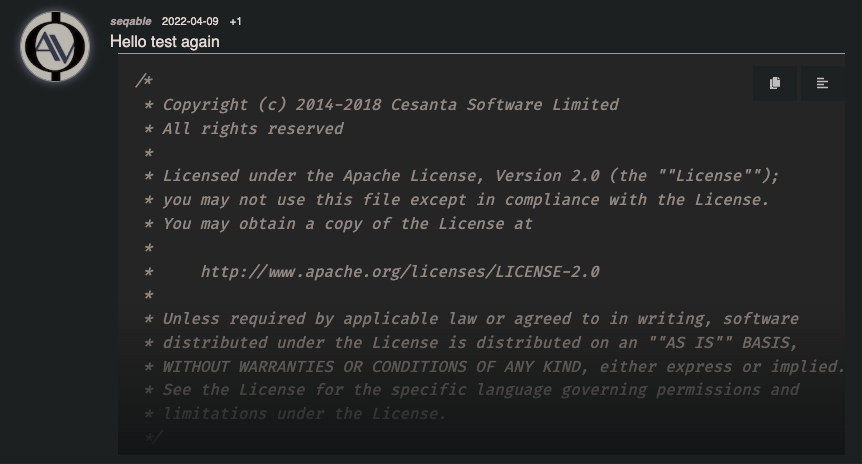

# Module stylesheets

`npm run build` compiles the shared `resources/scss/main.scss`, `dev.scss`,
`icons.scss` and the entry files
in `resources/scss/modules/` through the locked Sass and Autoprefixer packages.
Outputs are `resources/public/css/website/main.min.css`, `dev.min.css`, `icons.min.css`, and
`modules/<feature>.min.css`. The development document alone links `dev.min.css`,
which contains inspector styles; production shell and error pages share the same
fingerprinted shell link without loading those rules. Shared validation-error
markup stays in the common component error stylesheet. `lein repl` starts and
supervises a single watcher for shared/module SCSS, declarations, fonts, tools,
CMS overrides and output integrity. Shadow's existing public-directory watcher
reloads rebuilt CSS. `(stop)` and JVM shutdown release the owned watcher;
a dead watcher is restarted by the next development request or browser compile.
`npm run dev` can run independently for CSS-only work.
Set `CSS_OUTPUT_DIR` to build into a separate directory for comparisons.

## Development freshness

Startup, development browser compilation and HTML/CSS/direct browser-chunk delivery
verify the source revision and every raw/minified output digest. They rebuild
missing, stale or overwritten sheets before proceeding. Failed builds return 503
rather than delivering the previous CSS; unrelated media/API requests remain
independent. A changed verified revision refreshes the Optimus inventory without
waiting for its ordinary development TTL. Production still uses its prepared,
fingerprinted inventory and never compiles styles in request handlers.

The builder and all watchers serialize writes through `styles-lock.clj` and the
OS file lock at `.build.lock`. Leave that file in place; process exit releases
the lock without unlinking it. Individual CSS files and the completed revision
stamp are renamed atomically. Sources changed during a build are rebuilt again
before the stamp is published. The freshness check uses existing locked Node
and Babashka tools; it does not require a separate Sass process or Python.

## Production pruning

Production asset preparation runs `scripts/build/prune-styles.mjs` after Shadow
release and before Optimus reads/fingerprints CSS. Docker, uberjar prep and
`bb prod:build` share that boundary. The release manifest supplies all shipped
browser chunks (including lazy SDKs), the released Node renderer and document
scripts supply SSR/pre-hydration states, and server document sources supply JVM markup. The selected stylesheet
catalog supplies the shell, icons and enabled module sheets. Development
compilation/watch output remains complete.

PurgeCSS removes selectors absent from those inputs. Quoted class/ID prefixes
and suffixes retain runtime concatenations such as `"leaflet-" + kind`, `"fa-" +
glyph` and presence suffixes; attribute states and pseudo-only branches remain
available. For an opaque runtime class that cannot be inferred from its producer,
keep the narrow rule with Sass-preserved `/*! purgecss ignore */` inside it, or
`/*! purgecss start ignore */` / `/*! purgecss end ignore */` around that rule.
The Codox HTML subtree uses this narrow ownership boundary because its trusted
markup is generated separately from the frontend release. Do not safelist an
entire feature to conceal an unexplained missing selector.

Custom properties and keyframes use one reachability graph across all selected
sheets and theme overrides. Retained declarations, inline JavaScript references,
variable prefixes, bare names accepted by CSS-var helpers, fallbacks and CSS
query references keep their dependencies;
unused chains/cycles are removed. Unused font faces are removed after checking
retained CSS aliases and runtime font names. The build writes byte counts and
removed selectors/definition counts to `optimus/css-pruning.json`. Missing
release inputs or pruning errors prevent publishing the prepared asset manifest.
Production jars omit development inspector CSS and unprefixed CSS intermediates.
The complete selected SCSS/CLJS source remains in the on-site editor workspace,
including SCSS rules removed from runtime CSS; generated-output exclusions must
never filter those sources. Raw SCSS also remains a jar resource. SCSS previews
and preserved experiments are not deleted.

## CMS variable overrides

The CMS **Site features and pages** form has a multiline **CSS variable overrides**
field. **Publish site changes → CSS variable reference** shows the provisioned
site's actual `_vars.scss`, with a search field for names, defaults and comments.
The provisioning manifest carries this read-only source as base64 so environment
interpolation cannot change SCSS quotes or dollar signs; update the editor after
changing the source to refresh its reference. It accepts ordinary CSS custom properties, including existing names from
`scss/shell/_vars.scss`; there is no per-variable registration or parallel form.

```css
:root {
  --space: 1.5rem;
  --space-lg: calc(2 * var(--space));
  --line-width: 0.125rem;
}

@media (min-width: 60rem) {
  :root { --space: 2rem; }
}

html[data-theme="light"] {
  --bg-1: #f0eee8;
  --fg-1: #242628;
}
```

Selectors, media queries, native `var()`/`calc()`/color functions and comments are
retained. Supply CSS rather than Sass; declarations must be custom properties
(`--name`) inside selectors. Imports are rejected. Theme defaults have their own
selectors: use `html[data-theme="light"]` for explicit light mode, and
`@media (prefers-color-scheme: light) { :root:not([data-theme="dark"]) { ... } }`
for automatic light mode. A plain `:root` rule overrides the default root values
and responsive root rules, while more specific component/theme declarations
keep normal CSS precedence. Existing visitor appearance controls and the blog route's
line framing write inline custom properties, which take precedence over ordinary
stylesheet declarations. An author can deliberately pin a value across those
controls/routes with `--line-width: 0.125rem !important`; otherwise those existing
local overrides remain available. Use relative units for sizes.

`bb site:resolve` snapshots the authenticated `/api/site-config` response once:
boolean selections go to `resources/site.overrides.edn`, and its optional `styles`
text goes to `resources/site.overrides.css`. Both generated files are ignored and
excluded from Docker inputs/jars. Docker resolves them in its shared source stage
using existing BuildKit secrets; ordinary CSS builds consume the local snapshot
and make no network requests. For local CMS preview, export `STRAPI_URL` and
`STRAPI_READ_TOKEN`, run `bb site:resolve`, then `npm run build` or the CSS watcher.

The stylesheet builder parses the bounded 64 KiB CSS snapshot before writing
outputs, appends it only to the shell after source defaults, and includes it in
the freshness hash. Replacing or clearing it invalidates stale output; the watcher
also notices snapshot changes. The regular Optimus pipeline fingerprints the
combined sheet, so overrides arrive in the blocking first-paint stylesheet with
no extra browser/CMS request or hydration restyling. `_vars.scss` stays unchanged.
Older CMS responses, a missing CMS endpoint, or no configured CMS produce empty
overrides and retain source defaults. Other CMS/validation failures stop resolution.

Save the field and use **Publish site** to rebuild/deploy. Saving alone does not
restyle an existing deployment. Clear it and publish to restore the defaults.
Malformed CSS fails the build while retaining previous stylesheet output; it
does not become a partially applied theme.

Shared shell/layout rules live in `scss/shell`, reusable component rules in
`scss/components`, and feature implementations in `scss/modules/<feature>`.
Shared rules retain ordinary selector specificity; feature rules use their
module selectors and remain installed across navigation. Avoid splitting rules
that rely on ordering between equally specific selectors across features.
Keep mixins in CSS-free `scss/tools` partials: importing a
feature for a mixin would duplicate its selectors in another module's output.
`all.scss` remains an explicit combined preview entry, outside the normal build.
The `:home` sheet owns landing hero/page rules. Its Story gradient uses continuous
`:seen` visibility with `:restore? false`, so history returns also pause it offscreen.
Plain landing text does not acquire
Markdown/monospace sheets. Shared avatar rules stay in the shell; closed User,
Settings and Link Preview panels contribute no initial sheet. Query parameters
that initially open User or Settings include that panel's styles in the head. The preview's static
`display: contents` container rule belongs to Markdown, keeping SSR layout intact.
The optional `:styled-input`
module owns the custom field used by Search and blog editing. It, Markdown and
the deferred highlighter declare the independent monospace sheet, containing FiraCode's font declaration.
The highlighter shares Markdown's code/control sheet too, so standalone code consumers acquire their styles.
The common shell contains neither. Browsers acquire the font URL only when a rendered consumer uses
its glyphs; do not preload it merely because a Markdown module is loaded.

Open Sans uses eight local Unicode subsets in `public/css/opensans.css`, each
covering the font's native variable weight axis (300–800). Preserve those ranges
when refreshing the files so unused scripts do not download on Latin pages. The
shell preloads the existing Latin WOFF2 URL; its other subsets load only for their
glyphs. Keep remote Google font URLs and duplicate static TTF faces out of the
shell. The original Open Sans OFL notice accompanies the local files.

A module with no `:styles` entry automatically uses
`/css/website/modules/<id>.min.css` when that generated file or its matching SCSS entry exists. Build CSS
before compiling module inventories. Matching SCSS establishes ownership even
for cold backend AOT/packaging before the frontend generates its output. An explicit literal `:styles` vector replaces
this default: use it for additional/shared sheets, custom paths, or `[]` to opt out.
Every explicit entry must be a root-relative asset path beginning with `/`, such
as `/css/website/modules/test.min.css`; module IDs such as `"test"` are not paths.
Declaration discovery and the module schema reject relative entries before
Optimus loads the shared inventory.
Blog explicitly includes Markdown and monospace sheets for its streamed/cached
SSR content without making the parser or preview widgets hard bundle prerequisites.
The existing module declaration reader generates the shared stylesheet catalog
at compile time, including transitive bundle dependencies. No browser feature
code must load to discover its CSS. A module may declare `:ssr-styles :deferred`
when its styles apply only to intent-driven UI absent from SSR, such as a preview
popup. The default is `:initial`; dependencies retain their own policies.
Runtime acquisition of these optional sheets waits for hydration, window load,
two painted frames and idle time, with low fetch priority. It does not wait on
layout readiness, since CSS can itself block the owning boundary. Already installed
initial styles satisfy acquisition immediately. Ordinary module CSS still starts
before Shadow code. Do not defer styles needed by
visible static SSR content. Declaration macros register the entry sources
as Shadow resources so metadata changes invalidate their baked catalogs in
incremental builds. Restart Shadow watches after adding or removing module entry
files or conventional stylesheets so discovery sees the changed set.

Optimus bundles each declared stylesheet separately and publishes content-addressed asset
URLs with long cache lifetimes. The shared shell sheet stays a blocking,
cacheable link. Small initial route/dependency sheets are inlined from Optimus's
optimized contents, within a 16 KiB document budget, eliminating separate
feature requests before first paint. Larger sheets retain stylesheet links;
development keeps links for CSS watching. The `data-module-style` attribute
associates each inline sheet with its immutable URL in the small `#module-styles`
JSON inventory. The loader treats that sheet as already ready, avoiding duplicate
requests. Streamed skeletons and completed SSR pages share the initial head. The shell
retains the centered body width when it leaves document flow to dissolve.
Local return documents include their saved modules' CSS as links in the head.
When modules share a stylesheet, their manifest entries reference the same bundle;
the initial head and browser loader deduplicate that URL. Keep declared output
names distinct: the catalog rejects stylesheet bundle-name collisions.

The browser module loader starts CSS acquisition synchronously before calling
Shadow's JavaScript loader. React DOM `preinit` owns insertion and deduplication;
a small lifecycle adapter observes load/error with listener and timeout cleanup.
Code readiness waits for both CSS and JS, before installation or rendering.
CSS stays installed across navigation for cached modules. A failed request is
retryable through the existing module failure UI; retries use a new URL because
React retains resource records by href. Data acquisition remains independent.

Leaflet CSS and images come from the locked npm package, through the `:maps`
bundle dependency. They do not require a separate CDN version.

Verify initial head links, cold SPA acquisition timing, dependency CSS, failure
and retry, both navigation directions, hydration and document/history returns.
Use a separate production server with advanced compiled browser assets and the
Node renderer for performance measurements; port 4000's development assets are
not representative. See [testing.md](testing.md).

Module references defer code/data activation until proximity or explicit intent;
SSR styles remain available for the static view before hydration. CSS acquisition
starts directly when the module request starts, shares its in-flight promise, and
retries a failed CSS/code request once after three seconds before showing an error.

## Text font upgrades

Fira Code belongs to the independent monospace sheet. Its initial face uses
`font-display: optional`: a font unavailable within the browser's short initial
period does not later swap over visible SSR text automatically. The separate
`Fira Code Ready` family shares the same immutable font URL and is loaded through
`document.fonts.load` by the owning component. This adds no font to plain routes
or closed Search. Search's visible letters/suggestions activate the feature only
when open; fenced blocks and inline snippets own it when rendered.

A pending face keeps the original text visible. Once the ready face has loaded,
a decorative copy using that face is rendered behind it at zero opacity. After
two painted frames, both layers crossfade simultaneously for 100ms with linear
easing. The outgoing layer supplies layout during the fade; at completion React
removes it and retains the incoming layer as the sole accessible text. Neither
controls nor container backgrounds fade. The feature belongs on text-only roots;
do not duplicate inputs, IDs, component lifecycles or interactive descendants.
The highlighter supplies its already-generated native text tree to a stable
Reagent `PreTag` adapter, so crossfading does not mount a second formatter.

Readiness and phases are re-frame events; Reagent animation completion and a
bounded `:dispatch-later` deadline remove the old layer. Already loaded initial
faces retain the browser's first-paint choice without animation. Reduced motion
and local-return documents use one layer and skip the fade. Failure or the
ten-second load deadline leaves readable fallback text; stale completions cannot
revive an expired attempt or an unmounted owner.
Font loading never blocks hydration or the page-ready gate.

`Fira Code Fallback` uses locally installed Courier New. Its `size-adjust` is the
Retina font's advance ratio (1228/1229); its ascent/descent overrides divide the
Retina metrics by that ratio. This preserves monospace advances and line height
on systems with Courier New. Other systems use generic monospace, so exact metric
matching is not guaranteed there. The fade smooths the visual replacement; it
cannot interpolate kerning or glyph shapes. Open Sans retains its existing shell
policy; the Fira change does not fade the whole document.

Fenced code controls overlap the block's top-right corner. Like comment reply
buttons, they fade in on parent hover/active intent; keyboard focus reveals the
same controls. Copy, wrap and fold use declared SVG icons with accessible names
and hover labels. Their generated icon sheet belongs to Highlight and loads with
that module. Inline copy indicators remain at the end of the snippet.

Long comments constrain their text area, rather than the avatar/metadata/actions.
Their fade ends at the clipped text edge; when that edge crosses code, its width
matches the code rectangle. Non-scrolling clipping prevents focus/scroll intent
from moving the fade upward and revealing code underneath. Folded code has its own bounded fade.

The resulting code typography and controls:



## Declared icons

Declare literal dependencies beside their rendered owner, for example
`{:icons ["brands/github" "solid/copy"]}` in a `defc`, module spec or page route
data. Component/page declarations in a module folder belong to that module;
shared declarations belong to `:main`. An explicit `:module` may select another
known owner. Declarations must use literal vectors and known Font Awesome family
names; computed dependencies and missing glyphs fail generation.

`bb fonts:icons` reads these declarations without requiring browser namespaces.
It retains the committed original glyph outlines and bounds in
`resources/public/img/icons/generated/` SVGs. Declared icons render with native
Font Awesome glyphs in generated owner CSS, preserving original font rasterization,
fractional baselines and control dimensions. SVG masks have different line metrics
at some font sizes and must not replace these glyphs during technical refactors.
Shared glyph rules compile into the shell; feature rules get an automatically
catalogued `icons-<module>.min.css` dependency. Shared icons satisfy feature
requirements without duplicate rules. The small subset font faces are available
in the shell response; the full utility/catalog sheet stays deferred. Existing
Reagent `:i.fab.fa-github`/`:i.fas.fa-copy` markup, `currentColor` and native text
clipping for gradients remain usable. Font selection and original auto display
policy remain browser-owned.
Regenerate after changing declarations; commit generated SVGs, fonts and SCSS
together. The generator removes stale files only in its owned generated paths.
Normal CSS (and Docker) builds use these committed outputs, without Python/fontTools.

Shadow tracks existing icon declaration sources for incremental changes. Restart
the watch after introducing an icon declaration in a previously untracked source.
The source adapter is `.cljc` for the JVM/Babashka reader boundary; it does not
execute frontend code or create a runtime schema inventory.

## Icon fonts

The deferred `icons.css` bundle uses generated selectors for source/catalog glyphs,
shared Font Awesome utilities and generated font faces in one compressed output.
The shell also includes the face declarations for its declared native glyphs.
Development links that same watched output. Optimus fingerprints the sheet and
rewrites all of its font URLs, so repeat visits can reuse font bytes without
caching mutable original paths.

`bb fonts:icons` regenerates small WOFF2 faces from the vendored originals. It
collects literal `fa-*` names from application source and the CMS-driven names in
`resources/icon-fonts.json`; commit that catalog, the generated SCSS and both fonts.
The generated faces have disjoint Unicode ranges: known glyphs use the small
fonts, while other glyphs acquire the original full font when actually rendered.
A failed subset request can also fall back to the full font through native CSS
source selection.
Keep full originals available for regeneration. Dynamic icon consumers render
the pure `components.icon/<icon>` and explicitly acquire `:icon-catalog` for an
unknown name, including its CSS-before-code readiness. Known names
never load that compatibility sheet. Regenerate after
adding literal icons, changing catalog names, or replacing the vendored fonts.

Generation uses Python with `fonttools==4.60.2` and `Brotli==1.2.0`. These are
optional authoring tools, not server or Docker build dependencies; normal CSS
builds compile the committed generated SCSS. For an isolated setup, install them
in a virtual environment and run `bb fonts:icons` with that environment on PATH.
The generator retains font license/copyright records and names derivative fonts
separately. The subset face also includes U+20 in its CSS range to retain the
original line-box baseline; this does not add a glyph or overlap the full-font
fallback range. Verify glyph outlines/metrics, fresh-browser requests, the full-font
fallback and cache headers after changing it.

Build CSS as UTF-8 without a byte-order marker (`charset: false` in Sass). The
server also strips a leading marker before inlining third-party/optimized sheets;
a marker inside an HTML style element becomes part of its first selector.

Carousel controls/views and their independent sheet belong to `:carousel`. Home, CV
and Strava declare the bundle dependency; Blog and Search acquire neither its code
nor its stylesheet. The shared UI media interface acquires that module on use.

The footer's email/toggle remains eager. The closed contact form contributes no
initial code or CSS; opening it mounts the `:contact` boundary and starts both
resources. The page shell owns one popup outside both footer stacking contexts;
footer controls only toggle its shared state. Contact sits above the footer and
below the HUD, keeping notices actionable while the form is open.
Its popup sheet is deferred in ordinary SSR documents.

The closed Settings panel has no DOM, CSS-variable reads or view code in bootstrap.
Opening it acquires `:settings` and its sheet before mounting its controls.

Large originals default to progressive loading only when width exceeds 320,
longest edge is at least 960, and source size is at least 64 KiB. Bundled and
managed metadata share that eligibility predicate. Explicit `:progressive? true`
or `false` overrides it. Small responsive images retain their source set and one
final layer; large-but-cheap banners can still use the static color placeholder. Native pictures request the smallest AVIF/WebP preview and the normal final
srcset concurrently. The preview starts with 4rem blur; image scale/crop stay
unchanged. After a noticeable preview paint, blur clears over 100ms and opacity-out overlaps the sharp
final's opacity-in for 150ms, both linear. Reduced motion, cached final readiness,
and an opening entrance whose computed scaleX has not passed two thirds settle
sharp immediately; there is no minimum preview duration.

Each initial native image retains an exact wrapper/source owner through hydration.
Its React SSR identifier names document-mount CSS properties; the adapter writes
only that mount and the component adopts terminal readiness without replay.
Later component upgrades use keyed `defc :exit`/`:presence`; the preview span is
its painted motion root because `picture { display: contents }` cannot own an exit.
Transient readiness and decode completions remain guarded by node and currentSrc.

External departures and native history returns use the appropriate responsive
final directly. The head classifies Back before image discovery, suppressing lazy
previews; no preview preload is emitted. Paired SSR renders only the final.
BFCache keeps the direct policy during pending upgrades. Normal SPA navigation
clears it. A same-candidate selection also removes its redundant preview at commit,
without waiting for decode; the known 400w/100vw DPR1 bucket hides it before JS.
Shared wrappers retain media sizing, filters and object-fit through both layers.
Original-format recovery stays native to the source picture; a failed final may
retain usable preview except under the strict direct-return policy.

Image generation samples three oriented RGB rows into validated `:placeholder
{:colors [top middle bottom]}` metadata. The shared source helper derives a fixed
vertical gradient for SSR image boxes and the initial page skeleton. This static
background can release the document entrance before either image request finishes;
the native owner and component remove it when the selected final image decodes.
The gradient adds no request, client canvas work, scaling, or crop changes.

The original fixed `--line-width-base` owns the default border size. Blog framing
uses `--line-width-thin`, compiled from half that baseline; leaving Blog restores
the baseline. The header seam follows the active page's `--line-width`. These resolve to plain lengths so existing
visitor appearance controls can read and edit them. Do not replace these with rem
approximations, which change physical line sizes at responsive font sizes.
